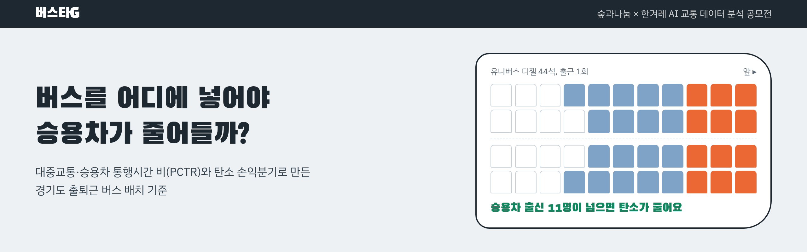
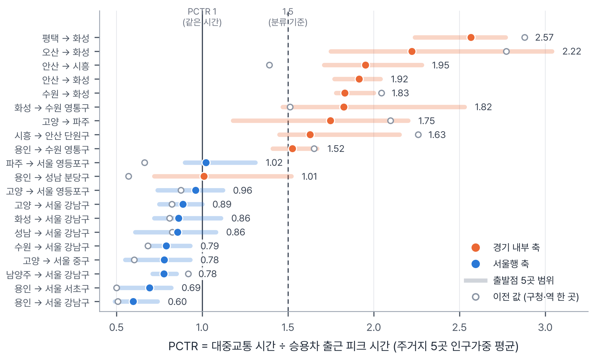
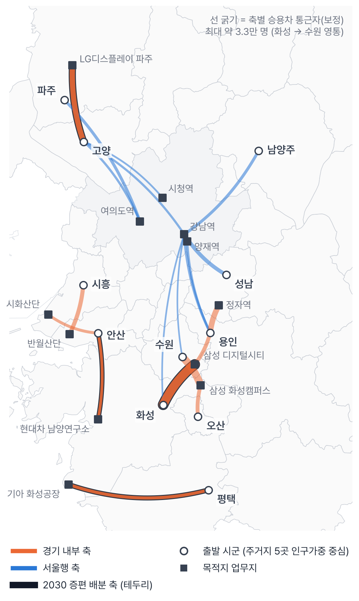
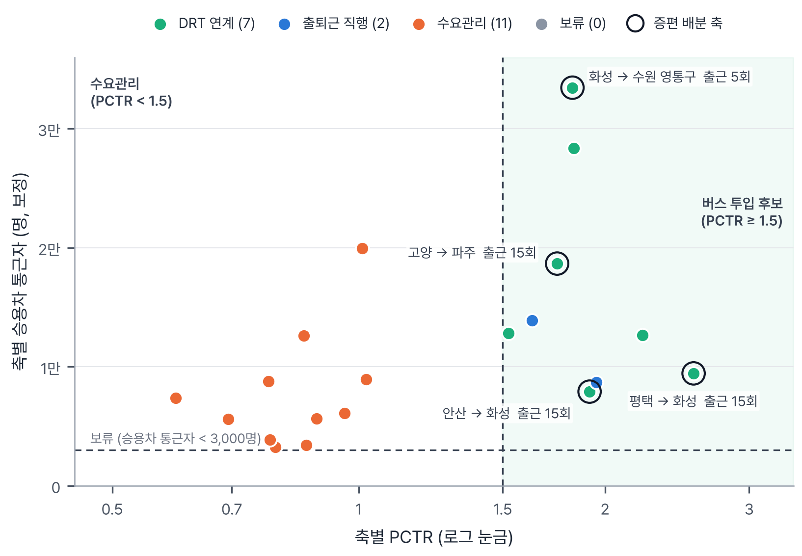
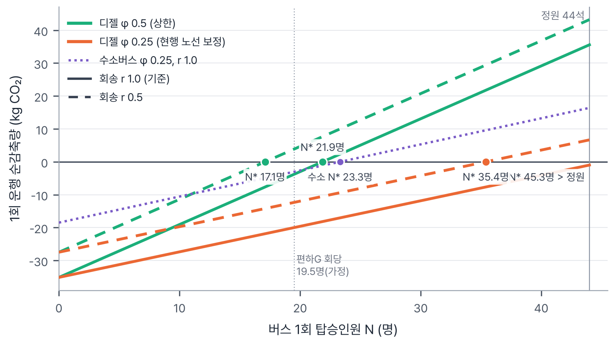
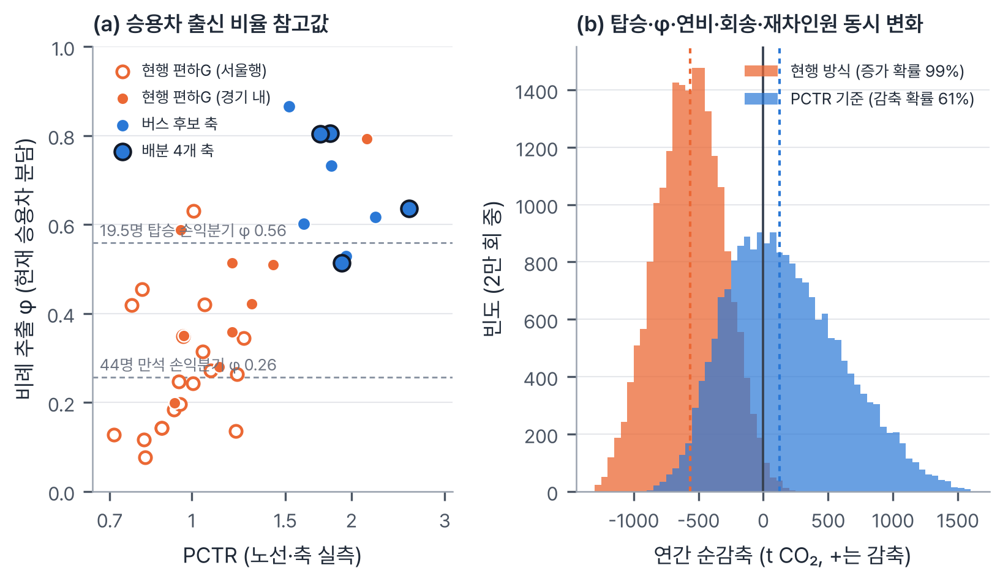

  <a href="https://ehdtn0843ds-dss.github.io/trafficman/"><b>인터랙티브 소개 페이지</b></a>
  &nbsp;|&nbsp;
  <a href="report/버스타G_분석보고서.pdf"><b>분석보고서 PDF</b></a>
  &nbsp;|&nbsp;
  <a href="docs/REPRODUCE.md">재현 가이드</a>

  
  
  

<table align="center">
<tr>
<td align="center" width="33%"><h3>약 11명</h3>버스 1회가 탄소를 줄이는 회당 승용차 출신 승객 수</td>
<td align="center" width="33%"><h3>61%</h3>PCTR 기준으로 배분했을 때 순감축일 확률</td>
<td align="center" width="33%"><h3>86%</h3>현행 방식으로 배분했을 때 순증가일 확률</td>
</tr>
</table>

숲과나눔 × 한겨레 「AI와 함께하는 교통문제 해결을 위한 데이터 분석 공모전」 출품작이에요. 이 페이지는 보고서 내용을 그림과 함께 읽기 쉽게 풀어 쓴 요약이고, 좌석 배치도로 손익분기를 직접 움직여 볼 수 있는 [소개 페이지](https://ehdtn0843ds-dss.github.io/trafficman/)도 있어요.

---

## 먼저 결론부터

- 출퇴근 버스 1회가 탄소를 줄이려면, 한 번 운행에 **원래 승용차로 출근하던 승객이 약 11명** 넘게 타야 해요. 버스가 크고 회송(빈 차 이동)도 있어서 그보다 적으면 오히려 배출이 늘어요.
- 지금 경기도 출퇴근 버스(편하G버스)는 대부분 전철이 이미 빠른 **서울행**이에요. 그래서 승객 상당수가 원래 대중교통 이용자이고, 이 기준을 못 넘을 가능성이 커요(2만 회 계산에서 순증가 확률 86%).
- 대중교통이 승용차보다 훨씬 느린 **경기 내부 산업단지 축**에 2030년 증편분을 넣으면 줄일 가능성이 더 커요(순감축 확률 61%, 모형 기준값으로는 연 약 1,020 tCO₂ 감축).

단, 이 결론은 "대중교통이 느린 축일수록 승용차를 두고 온 사람이 버스를 더 많이 탄다"는 가설 위에 서 있어요. 그래서 개통 전 설문과 시범 운행으로 이걸 확인하자는 게 저희 제안의 핵심이에요.

---

## 왜 이 질문을 했을까요?

경기도 통근자 상당수는 혼자 승용차를 몰고 시군 경계를 넘어요. 경기→서울 통근의 승용차 분담은 55%이고, 도내 시군 간 통근에서는 대중교통이 승용차보다 평균 2.1배 오래 걸린다고 해요(경기연구원).

경기도는 좌석·예약형 출퇴근 버스인 **편하G버스**를 하루 84회(2026)에서 184회(2030)로 늘릴 계획이에요. 그런데 노선은 도민 제안과 시군 수요조사로 정해지다 보니, 현행 28개 노선 대부분이 서울행이에요.

여기서 의문이 생겼어요. 서울행은 이미 전철이 빠른 길인데, 이 버스에 타는 사람들이 정말 승용차를 두고 온 걸까요? 원래 전철을 타던 사람이 옮겨 온 거라면 도로 위 승용차는 그대로이고, 버스 배출만 더해지는 셈이에요.

그래서 새 서비스를 만드는 대신, **이미 있는 버스를 어느 축에, 어떤 방식으로, 몇 회 넣어야 승용차가 실제로 줄어드는지** 정하는 기준을 데이터로 만들어 보기로 했어요.

---

## 핵심 아이디어: PCTR

PCTR(대중교통·승용차 통행시간 비)은 아주 단순한 숫자예요.

> **PCTR = 대중교통으로 걸리는 시간 ÷ 승용차로 걸리는 시간**

PCTR이 1보다 작으면 대중교통이 더 빠르고, 2라면 대중교통이 두 배 오래 걸린다는 뜻이에요. 사람들은 대중교통이 너무 느린 곳에서 승용차를 타니까, PCTR이 높은 축이 "버스를 넣으면 승용차를 끌어올 수 있는 곳"의 후보가 돼요.

다만 출발점을 구청이나 역 한 곳으로 잡으면 값이 크게 흔들려요. 그래서 시군마다 **주민이 가장 많이 사는 행정동 5곳**을 고르고, 각 동 안에서 아파트·주택이 가장 몰려 있는 실제 건물을 출발점으로 삼았어요. 그 5곳의 값을 인구로 가중 평균한 게 이 분석의 PCTR이에요.

승용차 통근이 많은 상위 20개 축의 PCTR. 막대는 출발점 5곳의 범위, 빈 원은 구청·역 한 곳에서 잰 값이에요.

---

## 어떻게 분석했나요?

1. **통근 축 찾기.** 국민연금 직장·거주지 이동 데이터에서 경기도에서 출발해 시군 경계를 넘는 통근 축 532개(211만 명)를 뽑고, 승용차 통근자가 많은 상위 20개 축을 골랐어요.
2. **시간 재기.** 출발점 55곳에서 목적지까지 승용차는 카카오모빌리티 API로 평일 오전 8시 출발 예측 시간을, 대중교통은 카카오맵 길찾기 추천 1순위 경로를 기록했어요. 현행 편하G 노선도 같은 방식으로 쟀어요.
3. **승용차를 얼마나 타는지 모형화.** 경기 31개 시군의 PCTR과 실제 승용차 통근 비율(인구총조사)로 로짓 회귀를 적합했어요(β = 3.20). PCTR이 오르면 승용차 비율이 얼마나 오르는지를 나타내는 값이에요.
4. **원인 진단.** 축마다 왜 대중교통이 느린지 보고 서비스를 정했어요. 대중교통이 이미 괜찮으면 수요관리, 정류장까지 걷는 게 문제면 DRT 연계, 차 안 시간과 환승이 문제면 출퇴근 직행이에요.
5. **탄소 손익분기 계산.** 현대자동차 공식 제원으로 유니버스 디젤 44석, 유니버스 수소전기버스, 쏠라티(DRT), 쏘나타(승용차)의 주행 연료를 차량 동역학 모델로 계산하고, 버스 1회가 승용차보다 탄소를 덜 내기 시작하는 탑승 인원 N\*를 구했어요.
6. **증편 배분과 검증.** 2030년 증편분 100회(출근 50 + 퇴근 50)를 탄소를 가장 많이 줄이는 축부터 배분하고, 현행 방식으로 나눴을 때와 비교했어요. 입력값 15개를 하나씩 흔드는 민감도 분석과 2만 회 몬테카를로로 결과가 얼마나 튼튼한지도 확인했어요.

---

## 무엇을 발견했나요?

### 1. 승용차 통근이 가장 많은 곳은 경기도 안쪽이에요

승용차 통근 상위 20개 축 중 절반(10개)이 서울이 아니라 경기도 안에서 오가는 축이에요. 1위는 화성→수원 영통(약 3.3만 명)이고요. 그런데 이 20개 축 중 편하G가 다니는 곳은 용인→서울 강남 하나뿐이에요.

경기 통근 축 개략도. 주황은 경기 내부, 파랑은 서울행, 검은 테두리는 증편을 배분한 4개 축이에요.

### 2. 서울행은 전철이 빠르고, 경기 내부는 차가 두 배 가까이 빨라요

- 축별 PCTR 평균은 경기 내부 **1.82**, 서울행 **0.82**예요.
- 출발점 하나하나로 봐도 PCTR 1.5 이상은 경기 내부 50곳 중 41곳, 서울행은 50곳 중 0곳이에요.
- 현행 편하G 28개 노선은 평균 1.06이고, 1.5를 넘는 노선은 1개뿐이에요.

### 3. 버스를 새로 넣을 만한 축은 9개예요

20개 축을 진단하니 수요관리 11개, DRT 연계 7개, 출퇴근 직행 2개가 나왔어요. 서울행 10개 축은 모두 수요관리예요.

재미있는 건 DRT 연계로 진단된 축에서도, 역까지 데려다주는 DRT(똑버스)가 승용차를 끌어오지 못했다는 점이에요. 똑버스 평균 대기(14분)가 걷는 시간을 줄여 얻는 이득보다 길었거든요. 그래서 이런 축에도 **아파트 단지 안에 정차하는 직행버스**를 권해요.

PCTR × 승용차 통근자로 본 분류. 테두리 원이 증편을 배분한 축이에요.

### 4. 기준은 "회당 승용차 출신 승객 약 11명"이에요

버스 1회 운행에는 꽤 많은 연료가 들고, 출근을 마친 버스가 빈 차로 돌아가는 회송도 있어요. 그래서 승객이 원래 승용차 이용자였던 비율(φ)이 낮으면 버스가 꽉 차도 손해예요.

- φ = 1.0이면 10.7명, 0.5면 21.9명, 0.25면 45.3명이 타야 본전이에요.
- 두 값을 곱한 **회당 승용차 출신 승객 수**로 보면, 탑승 인원이나 노선 길이와 거의 상관없이 **약 11명**이 기준이에요.
- 현행 편하G 수준(회당 약 19.5명, φ 0.25)이면 승용차 출신은 약 5명이라 기준에 못 미쳐요.

유니버스 디젤 44석 1회의 탄소 손익분기. 수소버스는 φ 0.25에서 23.3명이면 넘어요.

### 5. 같은 100회를 어디에 넣느냐에 따라 결과가 갈려요

| 구분 | 배분 대상 | 회당 탑승 × φ | 하루 이용 | 연간 순감축 |
|---|---|---|---|---|
| PCTR 기준 | 경기 내부 4개 축 | 44명 × 0.5 = 22명 | 2,200명 | **+1,020 tCO₂** |
| 현행 방식 | 현 28개 노선에 비례 | 19.5명 × 0.25 ≈ 5명 | 1,032명 | **−793 tCO₂ (증가)** |

배분된 4개 축은 평택→화성(기아 화성공장), 고양→파주(LG디스플레이), 안산→화성(현대차 남양연구소), 화성→수원 영통(삼성 디지털시티)이에요.

다만 "회당 44명, φ 0.5"는 모형이 내놓은 값이라 그대로 믿기는 어려워요. 그래서 탑승과 φ를 직접 바꿔 가며 다시 계산했어요.

| 회당 탑승 | φ = 0.25 | φ = 0.35 | φ = 0.5 |
|---|---|---|---|
| 20명 | −563 / −754 | −372 / −498 | −86 / −115 |
| 30명 | −340 / −455 | −54 / −72 | +375 / +502 |
| 44명 | −28 / −38 | +391 / +524 | +1,020 / +1,367 |

단위 tCO₂/년, 값은 "PCTR 기준 / 같은 조건의 현행 방식"이에요.

이 표에서 솔직하게 말씀드릴 점이 있어요. 탑승과 φ가 같다면 오히려 현행 방식의 절댓값이 더 커요(노선이 더 길어서요). 결국 PCTR 기준이 유리한 이유는 **"대중교통이 느린 축일수록 승용차 출신 승객이 많고 더 많이 탄다"**는 가설 하나예요.

그래서 이 가설을 세 가지로 점검했어요.

- 지금의 통근 수단 구성대로 승객이 온다고 보면, φ 참고값은 배분 4개 축이 0.69, 현행 노선이 0.33으로 약 2배 차이 나요.
- 4개 축이 기준을 넘으려면 축 승용차 통근자의 0.8%만 옮겨 오면 돼요. 반면 현행 방식은 φ가 0.56은 돼야 해요.
- 탑승·φ·연비·회송·재차인원을 근거 범위 안에서 동시에 뽑아 2만 번 계산했더니 PCTR 기준이 순감축일 확률은 **61%**(중앙값 연 124 t), 현행 방식이 순증가일 확률은 **86%**(중앙값 −388 t)였어요.

(a) 현행 노선과 버스 후보 축의 φ 참고값. (b) 2만 회 계산의 연간 순감축 분포.

### 덤: 원래 대중교통 타던 분들에게도 좋아요

버스 승객 중 일부(1−φ)는 원래 대중교통 이용자예요. 탄소는 줄지 않지만 다른 편익이 있어요. 서울행 노선은 광역버스·전철 출근 혼잡을 덜어 주고, 산단 축은 통근시간이 확 줄어요(평택→화성 151→69분, 안산→화성 96→60분, 화성→영통 74→51분, 고양→파주 63→46분).

---

## 그래서 이렇게 제안해요

1. **노선 선정에 'PCTR·N\* 검증 단계'를 넣어요.** 후보마다 주거지 5곳 PCTR이 1.5 이상인지, 개통 전 주민 설문으로 본 회당 승용차 출신 승객이 11명 이상인지 확인해요.
2. **2030 증편분은 경기 내부 산단 축부터 시범 배치해요.** 1년 운행 실적으로 11명 기준을 확인한 뒤 넓혀요.
3. **증편 목적을 먼저 정해요.** 탄소 감축이 목적이면 산단 축, 서울행은 출근 혼잡 완화 수단으로 봐요.
4. **걷는 게 문제인 축은 단지 안 정차 직행으로 운영해요.** 역 연계 DRT는 대기를 7~11분 이하로 줄일 수 있을 때만 써요.
5. **대기업 사업장 축은 기업 통근버스와 같이 짜요.** 기업 버스가 닿지 않는 주거지·협력사 직원을 도가 맡아요.
6. **데이터를 열어 주세요.** 노선별 탑승 실적과 이전 이용 수단 설문이 공개되면 이 기준을 노선마다 바로 검증할 수 있어요.

---

## 아쉬운 점도 있어요

- **승용차 출신 비율(φ)**: 편하G 이용자가 원래 뭘 타던 사람인지 공개된 설문이 없어서, 비슷한 서비스의 설문 값과 GTX-A 전환 사례로 대신했어요. 배분 축 목적지는 자체 통근버스가 있는 대기업이라 수요가 과대일 수도 있어요.
- **데이터 시점**: 수단 분담은 인구총조사 2020(코로나 시기) 기준이에요. 국민연금 직장 주소는 사업장 등록지라 본사 소재지가 과대 집계될 수 있어요.
- **측정 한계**: 카카오맵 PC웹 대중교통 길찾기에는 출발시각 설정이 없어 출근 시간대 혼잡이 반영되지 않았어요. 현대자동차가 유니버스 디젤과 쏠라티의 공인연비를 공개하지 않아 연비는 2차 자료로 산정했어요.

---

## 사용한 데이터

| 데이터 | 제공기관 | 출처 |
|---|---|---|
| 직장 거주지 이동 데이터 (2025-12) | 국민연금공단 | [공공데이터포털](https://www.data.go.kr/data/15167424/fileData.do) |
| 소요시간별·이용교통수단별 통근통학인구 (2020) | 통계청 | KOSIS DT_1PA2004 |
| 행정동별 주민등록 인구 (2026-09) | 행정안전부 | [주민등록 인구통계](https://jumin.mois.go.kr/) |
| 행정동 경계 (2026-07) | vuski/admdongkor | [GitHub](https://github.com/vuski/admdongkor) |
| 주거 건물 | OpenStreetMap | Overpass API |
| 편하G버스 노선·편성 | 경기도 | [경기도청](https://www.gg.go.kr/cont/easy_gbus/) |
| 승용차 통행시간 | 카카오모빌리티 | 미래 운행 정보 길찾기 API |
| 대중교통 통행시간 | 카카오 | 카카오맵 길찾기 (웹) |
| 대중교통 교차검증 | ODsay | ODsay LAB API |
| 차량 제원·공인연비 | 현대자동차, 한국에너지공단 | hyundai.com, min24.energy.or.kr |

입력값별 근거 문헌은 보고서 참고문헌과 [`sources/`](sources/)에 정리해 두었어요.

## AI는 이렇게 썼어요

Anthropic Claude(Claude 앱의 에이전트 작업)를 썼어요. 문제의식, PCTR로 대상지를 고르자는 아이디어, 분석 방향과 결과 검토는 팀이 맡았어요. Claude는 선행 조사, 데이터 전처리, 카카오맵 조회 자동화, 모델·민감도 코드 작성, 근거 문헌 조사, 시각화와 보고서 초안을 함께했어요. 보고서의 모든 수치는 이 저장소의 코드를 실행한 결과예요.

## 저장소 둘러보기

| 폴더 | 내용 |
|---|---|
| [`report/`](report/) | 분석보고서 PDF, 그림 |
| [`pctr_commute/`](pctr_commute/) | 수단 선택 모형, 탄소 손익분기, 증편 배분, 민감도·몬테카를로 코드와 결과 |
| [`resid/`](resid/) | 주거지 대표점과 통행시간 측정값 |
| [`apimeasure/`](apimeasure/) | 측정 좌표와 입력 생성 스크립트 |
| [`sources/`](sources/) | 입력값 근거 조사 기록 |
| [`docs/`](docs/) | 소개 페이지(index.html)와 [재현 가이드](docs/REPRODUCE.md) |
